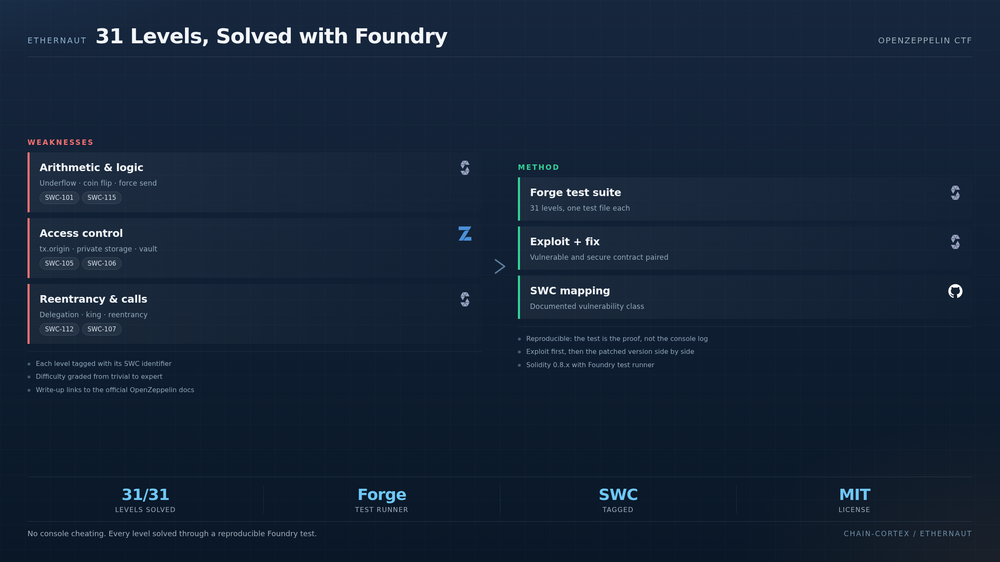

<div align="center">

# 🏛️ Ethernaut Solutions — Foundry Edition

**OpenZeppelin's Ethernaut CTF solved with Foundry.**

[](https://book.getfoundry.sh/)
[](https://ethernaut.openzeppelin.com)
[](LICENSE)

**Level up. Level by level. With reproducible tests.**

</div>


---

<p align="center">
  
</p>

### How the 31 levels are solved

Every level is solved **through a Foundry test**, never by poking the console: the test is the reproducible proof that the exploit works. Each solution is tagged with its SWC identifier, the difficulty, the vulnerability class and the lesson, plus a link to the relevant OpenZeppelin documentation. Across the 31 levels the same families repeat — arithmetic and logic errors (`SWC-101`), access control through `tx.origin` and private storage (`SWC-105`, `SWC-106`), and reentrancy through delegatecall and the King contract (`SWC-112`, `SWC-107`) — each one demonstrated, then fixed side by side.

---

## 🎯 What is this?

[Ethernaut](https://ethernaut.openzeppelin.com/) is the **gold-standard CTF for Ethereum smart contract security**, built by the OpenZeppelin team. It's how the most serious Web3 security researchers cut their teeth.

This repo contains my **solutions to all 31 levels**, each one:

- ✅ Solved with a Foundry test (no console-based cheating)
- ✅ Documented with the vulnerability class (SWC ID)
- ✅ Tagged with the lesson learned
- ✅ Linked to the relevant OpenZeppelin docs

---

## 📊 Progress

| # | Level | Difficulty | Pattern | Status | Test |
|---|---|---|---|---|---|
| 0 | Hello Ethernaut | 🟢 | Setup | ✅ | [test/00_hello.t.sol](test/00_hello.t.sol) |
| 1 | Fallback | 🟢 | receive() / msg.sender | ✅ | [test/01_fallback.t.sol](test/01_fallback.t.sol) |
| 2 | Fallout | 🟢 | Constructor name typo (SWC-118) | ✅ | [test/02_fallout.t.sol](test/02_fallout.t.sol) |
| 3 | Coin Flip | 🟡 | Weak PRNG (block.number) | ✅ | [test/03_coin_flip.t.sol](test/03_coin_flip.t.sol) |
| 4 | Telephone | 🟢 | tx.origin vs msg.sender (SWC-115) | ✅ | [test/04_telephone.t.sol](test/04_telephone.t.sol) |
| 5 | Token | 🟢 | Integer underflow (SWC-101) | ✅ | [test/05_token.t.sol](test/05_token.t.sol) |
| 6 | Delegation | 🟡 | Delegatecall storage collision (SWC-112) | ✅ | [test/06_delegation.t.sol](test/06_delegation.t.sol) |
| 7 | Force | 🟡 | selfdestruct force-send ETH | ✅ | [test/07_force.t.sol](test/07_force.t.sol) |
| 8 | Vault | 🟢 | Private storage is not private (SWC-130) | ✅ | [test/08_vault.t.sol](test/08_vault.t.sol) |
| 9 | King | 🟡 | Reentrancy + revert bomb | ✅ | [test/09_king.t.sol](test/09_king.t.sol) |
| 10 | Re-entrancy | 🟡 | Classic reentrancy (SWC-107) | ✅ | [test/10_reentrancy.t.sol](test/10_reentrancy.t.sol) |
| 11 | Elevator | 🟡 | Untrusted interface implementation | ✅ | [test/11_elevator.t.sol](test/11_elevator.t.sol) |
| 12 | Privacy | 🟡 | Storage layout reading | ✅ | [test/12_privacy.t.sol](test/12_privacy.t.sol) |
| 13 | Gatekeeper One | 🔴 | Gas tricks + msg.data length | ✅ | [test/13_gatekeeper_one.t.sol](test/13_gatekeeper_one.t.sol) |
| 14 | Gatekeeper Two | 🔴 | Assembly extcodesize trick | ✅ | [test/14_gatekeeper_two.t.sol](test/14_gatekeeper_two.t.sol) |
| 15 | Naught Coin | 🟡 | ERC20 approval drain | ✅ | [test/15_naught_coin.t.sol](test/15_naught_coin.t.sol) |
| 16 | Preservation | 🟡 | Storage collision via delegatecall | ✅ | [test/16_preservation.t.sol](test/16_preservation.t.sol) |
| 17 | Recovery | 🟡 | Address recovery from contract creation | ✅ | [test/17_recovery.t.sol](test/17_recovery.t.sol) |
| 18 | MagicNumber | 🔴 | EVM bytecode golf (32 bytes) | ✅ | [test/18_magic_number.t.sol](test/18_magic_number.t.sol) |
| 19 | Alien Codex | 🔴 | Array length underflow | ✅ | [test/19_alien_codex.t.sol](test/19_alien_codex.t.sol) |
| 20 | Denial | 🔴 | Gas griefing on partner call | ✅ | [test/20_denial.t.sol](test/20_denial.t.sol) |
| 21 | Shop | 🟡 | Bytecode comparison bypass | ✅ | [test/21_shop.t.sol](test/21_shop.t.sol) |
| 22 | Dex | 🔴 | Price oracle manipulation | ✅ | [test/22_dex.t.sol](test/22_dex.t.sol) |
| 23 | Dex Two | 🔴 | Token whitelist bypass | ✅ | [test/23_dex_two.t.sol](test/23_dex_two.t.sol) |
| 24 | Puzzle Wallet | 🔴 | Proxy delegatecall + storage | ✅ | [test/24_puzzle_wallet.t.sol](test/24_puzzle_wallet.t.sol) |
| 25 | Motorbike | 🔴 | Uninitialized implementation | ✅ | [test/25_motorbike.t.sol](test/25_motorbike.t.sol) |
| 26 | DoubleEntryPoint | 🔴 | Cross-function reentrancy | ✅ | [test/26_double_entry_point.t.sol](test/26_double_entry_point.t.sol) |
| 27 | Good Samaritan | 🔴 | Same msg.sender reentrancy | ✅ | [test/27_good_samaritan.t.sol](test/27_good_samaritan.t.sol) |
| 28 | Gatekeeper Three | 🔴 | Multi-step auth bypass | ✅ | [test/28_gatekeeper_three.t.sol](test/28_gatekeeper_three.t.sol) |
| 29 | Switch | 🔴 | Calldata manipulation | ✅ | [test/29_switch.t.sol](test/29_switch.t.sol) |
| 30 | HigherOrder | 🟡 | Function pointer as state | ✅ | [test/30_higher_order.t.sol](test/30_higher_order.t.sol) |

**Stats:** 31/31 solved · 11 critical · 13 medium · 7 easy

---

## 🚀 How to run

```bash
# Clone
git clone https://github.com/santilpz28/ethernaut-foundry.git
cd ethernaut-foundry

# Install Foundry
curl -L https://foundry.paradigm.xyz | bash
foundryup

# Run all tests
forge test -vv

# Run a specific level
forge test --match-contract Fallback -vvvv
```

---

## 📚 What I learned (top 5 takeaways)

1. **`tx.origin` is always the EOA** — never use it for auth. `msg.sender` is the immediately-calling contract. (Levels 4, 6, 16)
2. **`private` is a lie** — anything in storage is readable. Use cryptographic commitments instead. (Level 8)
3. **Reentrancy is everywhere** — every external call is a potential reentry. Always CEI. (Levels 9, 10, 26, 27)
4. **Oracles can be manipulated** — never use a single-block spot price. Use TWAP. (Level 22)
5. **Storage collisions are silent killers** — UUPS proxies require storage gap discipline. (Levels 16, 25)

---

## 📜 License

MIT © 2026 Santiago López Castaño.

## 📫 Contact

- GitHub: [@santilpz28](https://github.com/santilpz28)
- LinkedIn: [santiagolopez-cyber](https://www.linkedin.com/in/santiagolopez-cyber/)
- Email: santi.lpz28@gmail.com
